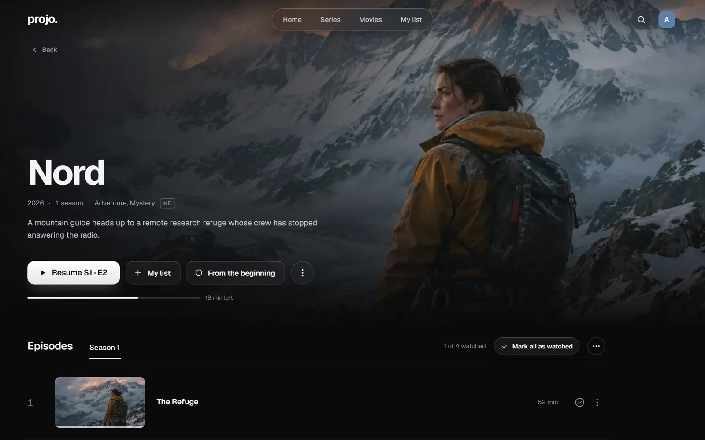
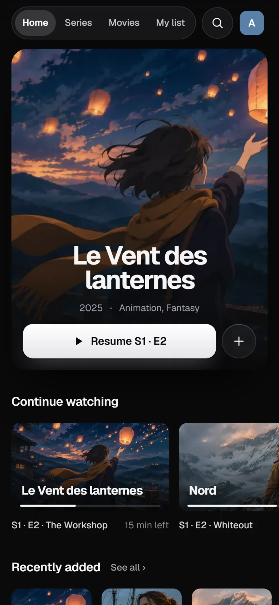
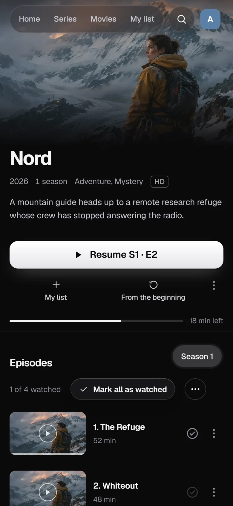

<h1 align="center">projo</h1>

<p align="center">
  A self-hosted media server for movies and TV shows, made for a household.<br />
  Point it at your video files and watch them in a clean, streaming-style interface.
</p>

<p align="center">
  <a href="https://getprojo.com">Website</a> ·
  <a href="https://getprojo.com/installation/">Installation guide</a> ·
  <a href="https://github.com/LeoMartinDev/projo/releases">Releases</a>
</p>


<table>
  <tr>
    <td width="40%"></td>
    <td width="40%"></td>
    <td width="10%"></td>
    <td width="10%"></td>
  </tr>
</table>

<sub>Titles and artwork in these screenshots are fictional.</sub>

## Features

- **Movies and shows identified automatically** with [TMDB]: posters, overviews, cast. Messy folders welcome.
- **Plays any file in the browser**: direct play when possible, remux or transcode otherwise (optional Intel VAAPI).
- **Continue watching, skip intro and credits, next episode autoplay**, audio and subtitle choices remembered per show.
- **For the whole family**: accounts invited by link, profiles with a PIN, per-library access and content ratings.
- **Updates from the admin page**, with automatic rollback if the new version does not start.
- English and French, installable as an app (PWA), on desktop, tablet and phone.

projo does not handle music, photos, live TV, casting or file renaming.

## Quick start

On a Linux machine (x86_64 or arm64) with Docker, create a `docker-compose.yml`:

```yaml
services:
  projo:
    image: ghcr.io/leomartindev/projo:latest
    ports:
      - '8080:8080'
    volumes:
      - ./projo-data:/data
      - /path/to/your/movies:/media/movies:ro
      - /path/to/your/shows:/media/shows:ro
    stop_grace_period: 30s
    restart: unless-stopped
```

```bash
docker compose up -d
```

Open `http://<your-machine>:8080`, create the administrator account and pick your folders in `/media`. Add a free [TMDB API key][TMDB] in **Administration → Metadata** so that files get identified.

The [installation guide](https://getprojo.com/installation/) covers the rest: [file permissions](https://getprojo.com/installation/#permissions), [hardware transcoding](https://getprojo.com/installation/#gpu), [running behind a reverse proxy](https://getprojo.com/installation/#proxy), [naming your files](https://getprojo.com/installation/#naming), [updates](https://getprojo.com/installation/#updates), [backups](https://getprojo.com/installation/#backup) and [troubleshooting](https://getprojo.com/installation/#troubleshooting).

## Development

Requires [Bun](https://bun.sh) (the version in `package.json`'s `packageManager`), plus `ffmpeg`, `ffprobe` and `fpcalc` in the `PATH`.

```bash
bun install
bun run dev     # server on :8080, web app on :5173
bun run test
```

[CLAUDE.md](CLAUDE.md) describes the code layout, the architecture rules and every command. The specification is in [PRODUCT.md](PRODUCT.md), the Docker image and the release process in [runtime/README.md](runtime/README.md).

## Credits

Metadata and images provided by [TMDB]; this product uses the TMDB API but is not endorsed or certified by TMDB. Intro and credits markers from [TheIntroDB](https://theintrodb.org/), [IntroDB](https://introdb.app/) and [SkipDB](https://skipdb.tv/). Naming conventions inspired by Jellyfin and Infuse.

## License

MIT.

[TMDB]: https://www.themoviedb.org/
